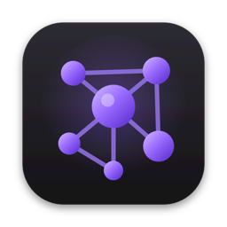
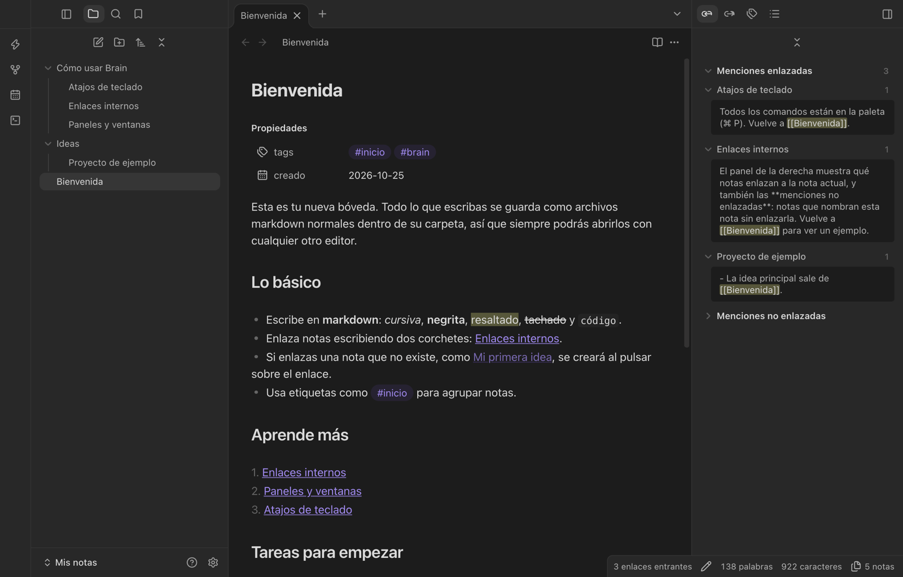
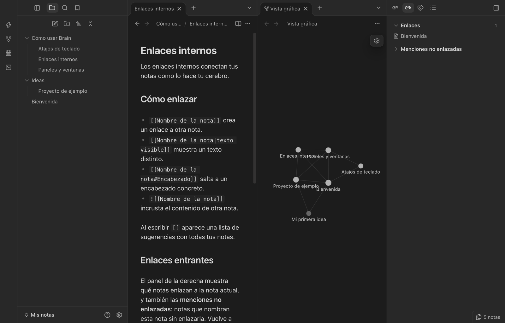
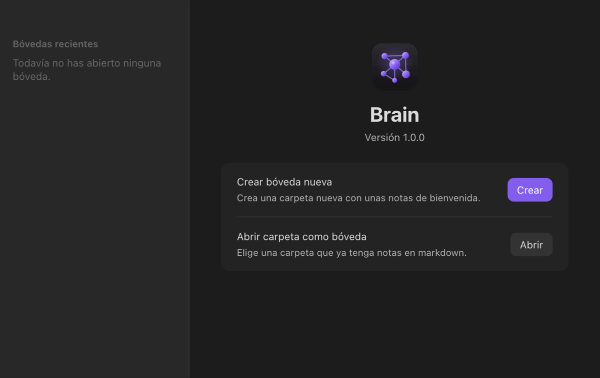
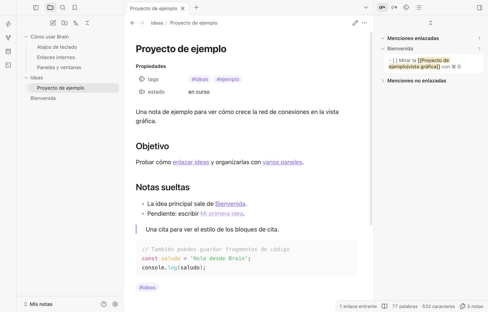

<p align="center">
  
</p>

<h1 align="center">Brain</h1>

<p align="center">
  Editor de notas en markdown para macOS, inspirado en Obsidian.<br>
  Sus funciones básicas, con su mismo aspecto, sin plugins ni complicaciones.
</p>

> [!NOTE]
> **Brain es un proyecto personal e independiente.** No tiene ninguna relación con Obsidian ni con sus creadores, que no lo patrocinan ni lo respaldan. Su interfaz imita la de Obsidian y su código es original. «Obsidian» es una marca de sus respectivos propietarios y aquí solo se menciona como referencia.



## Qué incluye

- **Explorador de archivos y carpetas** en la barra lateral: crear, renombrar, mover arrastrando, duplicar y eliminar (a la papelera).
- **Markdown** con vista previa en vivo (oculta la sintaxis fuera de la línea en la que escribes), modo fuente y vista de lectura.
- **Enlaces internos** `[[nota]]` con autocompletado, alias `[[nota|texto]]`, enlaces a encabezados `[[nota#encabezado]]` e incrustaciones `![[nota]]` o de imágenes.
- **Los enlaces se actualizan solos** al renombrar o mover una nota.
- **Panel derecho** con enlaces entrantes (incluidas las menciones sin enlazar), enlaces salientes, etiquetas y esquema.
- **Barra de estado** con enlaces entrantes, palabras, caracteres y número de notas.
- **Pestañas, paneles divididos y ventanas independientes**, que se recuerdan al cerrar la app.
- Selector rápido, paleta de comandos, búsqueda en todos los archivos, vista gráfica, marcadores, nota diaria, tareas, callouts, propiedades (frontmatter), plegado de encabezados y tema claro y oscuro.



## Qué no incluye

- Plugins, Canvas, sincronización ni versión móvil.
- Edición de tablas celda a celda (se muestran renderizadas y al pulsarlas se edita el markdown).
- Solo se ha probado en macOS.

## Tus notas son tuyas

Las notas son archivos `.md` normales dentro de la carpeta que elijas (la «bóveda»). Puedes abrirlas con cualquier editor, también con Obsidian. Brain guarda el estado de la bóveda (pestañas, ajustes, marcadores) en una subcarpeta oculta `.brain`.

La primera vez que abres Brain eliges si crear una bóveda nueva, con unas notas de bienvenida, o abrir una carpeta que ya tenga notas.



## Instalación

Necesitas macOS, [Node.js](https://nodejs.org) 20 o superior y git.

```bash
git clone https://github.com/miquelbaixas/brain.git
cd brain
npm install
npm start
```

Para tener una aplicación de doble clic:

```bash
npm run package
```

Se crea `Brain.app` en la carpeta del proyecto. Arrástrala a Aplicaciones o al Dock.

**Modo portátil:** si junto a `Brain.app` hay una carpeta llamada `.userdata`, Brain guarda ahí su configuración en lugar de `~/Library/Application Support/Brain`.

## Atajos principales

| Acción | Atajo |
| --- | --- |
| Nota nueva | ⌘ N |
| Selector rápido | ⌘ O |
| Paleta de comandos | ⌘ P |
| Buscar en todos los archivos | ⌘ ⇧ F |
| Buscar en la nota | ⌘ F |
| Alternar lectura y edición | ⌘ E |
| Vista gráfica | ⌘ G |
| Nueva pestaña y cerrar pestaña | ⌘ T y ⌘ W |
| Atrás y adelante | ⌘ ⌥ ← y ⌘ ⌥ → |
| Negrita, cursiva y casilla de tarea | ⌘ B, ⌘ I y ⌘ L |
| Ajustes | ⌘ , |



## Cómo está hecho

[Electron](https://www.electronjs.org), [CodeMirror 6](https://codemirror.net), [markdown-it](https://github.com/markdown-it/markdown-it), [d3-force](https://github.com/d3/d3-force) para la vista gráfica e iconos de [Lucide](https://lucide.dev).

| Carpeta | Contenido |
| --- | --- |
| `electron/` | Proceso principal: ventanas, acceso a los archivos y vigilancia de cambios |
| `src/js/` | Interfaz: espacio de trabajo, editor, vistas y paneles |
| `src/app.css` | Tema |
| `starter/` | Notas de bienvenida de las bóvedas nuevas |
| `scripts/` | Icono y empaquetado de `Brain.app` |

## Licencia

[MIT](LICENSE). Puedes usarlo, modificarlo y compartirlo libremente.

---

## English

**Brain** is a markdown note editor for macOS inspired by Obsidian. It reproduces Obsidian's look and its basic features: file explorer, internal `[[links]]` with automatic updates on rename, live preview, backlinks and outgoing links, tags, outline, graph view, tabs, split panes and separate windows. The interface is in Spanish.

Brain is an independent personal project. It is not affiliated with, sponsored or endorsed by Obsidian or its makers. "Obsidian" is a trademark of its respective owners and is mentioned only for reference.

Quick start (macOS, Node.js 20+): `git clone https://github.com/miquelbaixas/brain.git && cd brain && npm install && npm start`. Build a double-click app with `npm run package`. MIT licensed.
